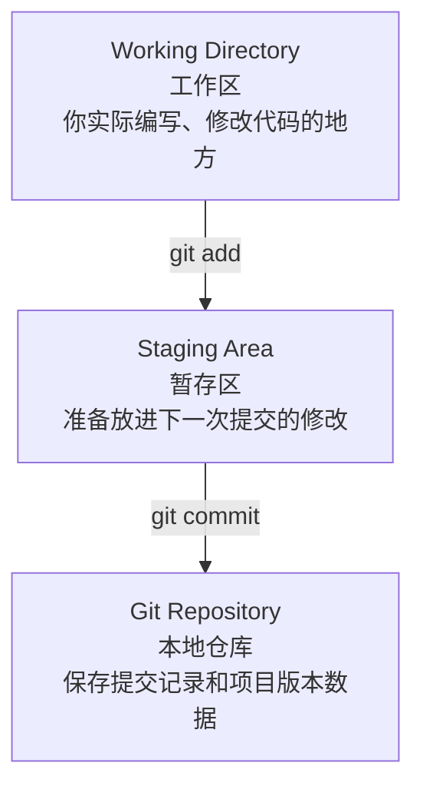
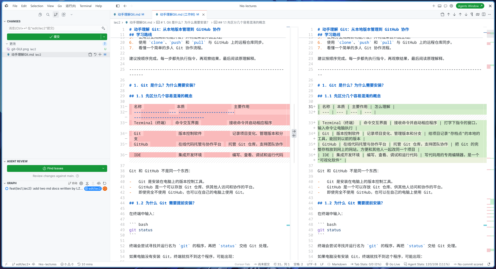
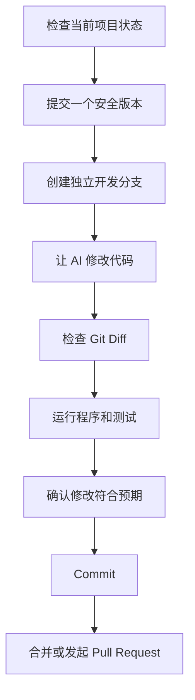

# 动手理解 Git：从本地版本管理到 GitHub 协作

> 海客松开发者培训材料\
> 本文件以动手实践为主。建议使用 Ubuntu / WSL 终端，配合 VS Code、TRAE
> 等 IDE 完成操作。\
> 学习目标不是背诵指令，而是理解 Git
> 如何记录项目变化、管理版本，以及支持多人协作。

---

## 学习路线

完成本教程后，你应该能够：

1.  解释 Git、GitHub、终端和 IDE 分别是什么。
2.  在自己的项目目录中初始化 Git 仓库。
3.  理解工作区、暂存区和本地仓库之间的关系。
4.  使用 `add`、`commit` 和 `log` 管理项目版本。
5.  使用分支隔离新功能开发，并将成果合并回主线。
6.  使用 `clone`、`push` 和 `pull` 与 GitHub 上的远程仓库同步。
7.  看懂一个简单的多人 Git 协作流程。

建议按顺序完成。每一步都先执行指令，再观察结果，最后阅读原理解释。

---

# 1. Git 是什么？为什么需要安装？

## 1.1 先区分几个容易混淆的概念

| 名称 | 本质 | 主要作用 | 怎么理解 |
| --- | --- | --- | --- |
| Terminal（终端） | 命令交互界面 | 接收命令并启动相应程序 | 打字下指令的窗口，输入命令让电脑执行 |
| Git | 版本控制软件 | 记录项目变化、管理版本和分支 | 给项目记录“存档点”的本地的工具，能回到以前的版本 |
| GitHub | 在线代码托管与协作平台 | 托管 Git 仓库，支持团队协作 | 把 Git 的完整存档放到网上的网站，方便和其他人一起改同一个项目 |
| IDE | 集成开发环境 | 编写、查看、调试和运行代码 | 写代码用的专用编辑器，是一个“可视化软件” |

Git 和 GitHub 不是同一个东西：

-   Git 是安装在电脑上的版本控制工具。
-   GitHub 是一个可以存放 Git 仓库、供其他人访问和协作的平台。
-   即使完全不使用 GitHub，也可以在自己的电脑上使用 Git。

## 1.2 为什么 Git 需要提前安装？

在终端中输入：

``` bash
git status
```

终端会尝试寻找并运行名为 `git` 的程序，再把 `status` 交给 Git 处理。

如果电脑没有安装 Git，终端就找不到这个程序，可能出现：

``` text
Command 'git' not found
```

这和输入 `python main.py` 时需要电脑中存在 Python
解释器是类似的：终端只是操作入口，并不自带所有软件的功能。

## 1.3 检查并安装 Git

先检查：

``` bash
git --version
```

如果返回类似：

``` text
git version 2.xx.x
```

说明已经安装，可以继续。

如果提示找不到命令，可以根据第二节课的课前文档中的 Git 安装说明进行安装。

## 1.4 设置提交者信息

第一次使用 Git 时，建议设置提交记录中显示的姓名和邮箱：

``` bash
git config --global user.name "Your Name"
git config --global user.email "you@example.com"
```

检查设置：

``` bash
git config --global --list
```

这里的姓名和邮箱用于标记提交记录中的作者信息，不等于 GitHub
登录认证，也不会自动把代码上传到 GitHub。

---

# 2. 创建第一个 Git 仓库

先不急着学习很多指令。我们从一个普通文件夹开始，观察 Git 如何接管它。

## 2.1 创建项目文件夹

在终端输入：

``` bash
mkdir git-practice
cd git-practice
```

这两条命令分别表示：

-   `mkdir git-practice`：创建名为 `git-practice` 的文件夹。
-   `cd git-practice`：进入这个文件夹。

查看当前目录：

``` bash
pwd
```

`pwd` 会显示当前所在路径。

## 2.2 初始化 Git 仓库

执行：

``` bash
git init
```

你可能会看到类似提示：

``` text
Initialized empty Git repository in .../git-practice/.git/
```

这表示 Git 已经在当前目录初始化了一个仓库。

接着查看隐藏文件：

``` bash
ls -a
```

你会看到：

``` text
.
..
.git
```

其中 `.git` 是 Git
的核心管理目录。它保存版本控制所需的对象、提交记录、分支等管理信息。

因此，可以先把一个 Git 仓库理解为：

**普通项目文件夹 + `.git` 管理信息。**

注意：`.git`
通常是隐藏目录。不要为了清理空间而随意删除它；删除后，这个目录中的 Git
版本历史和仓库管理信息也会丢失。

## 2.3 初始化究竟做了什么？

`git init` 不会自动上传代码，也不会自动为项目创建一份正式版本。

它只是让 Git 开始管理当前目录，为后续的状态检查、暂存和提交建立基础。

此时，你已经拥有一个本地 Git 仓库，但里面还没有正式提交的项目版本。

---

# 3. 理解 Git 的三个核心区域

在正式提交代码之前，先理解 Git 最重要的工作机制。

Git 的本地版本管理可以分为三个核心区域：



## 3.1 工作区（Working Directory）

工作区就是你平时通过 IDE 或文件管理器实际编辑项目文件的地方。

例如，你在项目中创建 `main.py`，并写入：

``` python
print("Hello Git")
```

这个文件现在存在于项目目录中，但它还没有被正式提交到 Git 的版本历史中。

## 3.2 暂存区（Staging Area）

暂存区是下一次提交的准备区域。

执行：

``` bash
git add main.py
```

Git 就会把 `main.py` 当前的内容变化放入暂存区。

为什么需要暂存区？

假设你同时修改了三个文件：

-   `main.py`：完成角色移动。
-   `enemy.py`：修改敌人 AI。
-   `config.json`：调整游戏难度。

但你这次只想提交角色移动功能，就可以只执行：

``` bash
git add main.py
```

这样，下一次提交就只会包含已经放入暂存区的修改。

## 3.3 本地仓库（Git Repository）

执行：

``` bash
git commit -m "完成角色移动"
```

Git 就会把暂存区中的内容记录为一次正式提交。

Commit
是一个可以追踪的版本记录。每次提交都有自己的标识符、作者信息、提交说明和父提交关系。

可以把它理解为项目历史中的一个正式存档点。

## 3.4 这三个区域之间的关系

-   修改文件：工作区发生变化。
-   执行 `git add`：选择要提交的修改，放入暂存区。
-   执行 `git commit`：把暂存区内容记录为一个版本。

注意：

-   `git add` 不等于上传到 GitHub。
-   `git commit` 也不等于上传到 GitHub。
-   前两者都可以完全在本地离线完成。

---

# 4. 第一次提交：亲自创建一个版本

现在开始完成第一个完整实验。

## 4.1 创建文件

确保你仍在 `git-practice` 目录中，执行：

``` bash
echo "print('Hello Git')" > main.py
```

这条命令会创建 `main.py`，并写入一行 Python 代码。

查看目录：

``` bash
ls
```

应该能看到：

``` text
main.py
```

## 4.2 查看 Git 状态

执行：

``` bash
git status
```

你会看到类似信息：

``` text
Untracked files:
  main.py
```

这说明 Git 发现了一个新文件，但它还没有被纳入版本控制。

`git status`
是一个非常重要的指令。开发过程中，可以经常使用它检查当前仓库处于什么状态。

## 4.3 把文件加入暂存区

执行：

``` bash
git add main.py
```

再次检查：

``` bash
git status
```

你会发现 `main.py` 已经进入暂存状态，等待提交。

如果希望把当前目录下所有适合纳入 Git 的修改都加入暂存区，也可以使用：

``` bash
git add .
```

但初学时建议先明确自己准备提交哪些文件，再决定是否使用 `git add .`。

## 4.4 检查准备提交的内容

执行：

``` bash
git diff --staged
```

这条命令可以查看暂存区中相对于当前提交版本的变化。

第一次提交时，你会看到 `main.py` 中新增的内容。

这一步非常有用：提交之前先检查自己究竟准备提交什么。

## 4.5 创建第一个 Commit

执行：

``` bash
git commit -m "Initial commit"
```

其中：

-   `commit`：创建一次提交。
-   `-m`：指定提交说明。
-   `"Initial commit"`：本次提交的描述。

执行成功后，Git 会返回本次提交的相关信息。

## 4.6 查看提交历史

执行：

``` bash
git log --oneline
```

你会看到类似：

``` text
a1b2c3d Initial commit
```

其中 `a1b2c3d` 是提交哈希值的简短显示形式，可以用于识别这次提交。

现在，你已经完成了：

1.  创建项目文件。
2.  检查仓库状态。
3.  将文件加入暂存区。
4.  创建正式提交。
5.  查看版本历史。

---

# 5. 修改代码：理解 Git 如何追踪变化

现在我们已经有了第一个版本。接下来修改代码，观察 Git 如何识别新变化。

## 5.1 修改文件

执行：

``` bash
echo "print('Hello Version 2')" >> main.py
```

这里使用 `>>`，表示在文件末尾追加内容，而不是覆盖原有内容。

查看文件：

``` bash
cat main.py
```

你应该能看到两行代码。

## 5.2 检查状态

执行：

``` bash
git status
```

Git 会告诉你 `main.py` 已经发生变化，但这次修改尚未暂存。

## 5.3 查看具体修改

执行：

``` bash
git diff
```

你会看到类似：

``` diff
+print('Hello Version 2')
```

`git diff` 用来查看工作区中尚未暂存的变化。

再执行：

``` bash
git diff --staged
```

如果刚才还没有执行 `git add`，这里通常不会显示这次新修改。

这两个命令的区别：

  命令                  查看什么
  --------------------- --------------------------------
  `git diff`            工作区中尚未暂存的变化
  `git diff --staged`   已经放入暂存区、准备提交的变化

## 5.4 再次提交

执行：

``` bash
git add main.py
git diff --staged
git commit -m "Add version 2 message"
```

查看历史：

``` bash
git log --oneline
```

现在应该能看到两次提交。

例如：

``` text
b2c3d4e Add version 2 message
a1b2c3d Initial commit
```

你已经拥有两个可以追踪的版本。

## 5.5 Git 是否真的保存了完整的项目历史？

Git 使用基于内容的对象存储机制管理数据。

简单理解：

-   文件内容会被保存为对象。
-   目录结构会被记录为树对象。
-   Commit 会记录一次项目快照、提交信息以及父提交关系。
-   相同内容可以复用已有对象。

所以，Git
不只是给项目文件夹不断复制、重命名。它建立了一套能够追踪和关联项目历史的数据结构。

---

# 6. 分支（Branch）：如何安全地开发新功能？

分支是 Git 非常重要的功能。

假设你正在开发一款游戏，当前稳定版本位于 `main` 分支。

现在你想尝试新的战斗系统，但不希望实验中的修改直接影响主线。

这时就可以创建一个新的分支。

## 6.1 查看当前分支

执行：

``` bash
git branch
```

你可能会看到：

``` text
* main
```

星号表示当前所在的分支。

## 6.2 创建并切换到新分支

执行：

``` bash
git switch -c feature-battle
```

这条命令同时完成两件事：

1.  创建名为 `feature-battle` 的新分支。
2.  立即切换到这个分支。

再次查看：

``` bash
git branch
```

应该能看到：

``` text
* feature-battle
  main
```

## 6.3 在新分支上开发

执行：

``` bash
echo "print('Battle system')" >> main.py
```

然后提交：

``` bash
git add main.py
git commit -m "Add battle system prototype"
```

现在，你已经在 `feature-battle` 分支上完成了一次提交。

## 6.4 切回主分支

执行：

``` bash
git switch main
```

再查看：

``` bash
cat main.py
```

你会发现刚才在 `feature-battle` 分支中追加的内容不再显示。

这是因为你切换到了另一个分支，Git
会将工作区切换到对应分支所记录的版本状态。

再切回去：

``` bash
git switch feature-battle
```

你会发现刚才的内容又回来了。

这说明分支并不是简单复制出一个新文件夹，而是通过不同的提交历史指针管理不同的开发路线。

## 6.5 合并分支（Merge）

假设你已经完成了战斗系统的初步开发，现在决定将它合并到正式主线。

先切换回主分支：

``` bash
git switch main
```

执行：

``` bash
git merge feature-battle
```

Git 会尝试把 `feature-battle` 的成果合并进当前的 `main` 分支。

如果没有冲突，合并通常可以自动完成。

查看历史：

``` bash
git log --oneline --graph --all
```

你可以更直观地观察不同分支和提交之间的关系。

### 分支相关指令小结

  指令                   功能
  ---------------------- --------------------------
  `git branch`           查看本地分支
  `git branch 名称`      创建分支
  `git switch 名称`      切换到已有分支
  `git switch -c 名称`   创建并切换分支
  `git switch -`         切回上一个分支
  `git merge 名称`       将指定分支合并到当前分支

补充：旧教程中经常出现 `git checkout`。它也能用于切换分支，但现代 Git
中，`git switch` 更明确地表达了分支切换的意图。

---

# 7. GitHub：从本地仓库到远程仓库

前面所有实验都可以在没有网络的情况下完成。

现在，我们让本地项目与 GitHub 上的远程仓库建立联系。

## 7.1 GitHub 是什么？

GitHub 是一个以 Git 为基础的代码托管和协作平台。

它主要提供：

-   代码仓库托管。
-   多人协作开发。
-   分支与 Pull Request。
-   Issue 和项目任务管理。
-   提交历史查看。
-   自动化测试和部署等开发流程。

本地 Git 负责版本控制，GitHub 负责在线托管和协作。

## 7.2 创建远程仓库

打开：

https://github.com

登录账号后：

1.  点击创建新仓库（New repository）。
2.  仓库名称填写 `git-practice`。
3.  选择 Public 或 Private。现在建议选择 Public，否则后面过程比较麻烦。以后的项目应该在向公众发布前选择 Private，发布后选择 Public。
4.  初次练习建议创建空仓库，不要额外初始化 README、`.gitignore` 或
    License。
5.  点击 Create repository。

创建完成后，GitHub 会提供一个仓库地址，通常类似：

``` text
https://github.com/你的用户名/git-practice.git
```

请使用你自己的仓库地址。

## 7.3 将本地仓库连接到 GitHub

回到终端，确保你仍在本地的 `git-practice` 项目目录中。

执行：

``` bash
git branch -M main
```

将当前分支名称设为 `main`。

然后执行：

``` bash
git remote add origin https://github.com/你的用户名/git-practice.git
```

这里：

-   `remote`：管理远程仓库。
-   `add`：添加一个远程仓库地址。
-   `origin`：给这个远程仓库起的默认名称。
-   后面的 URL：远程仓库实际地址。

检查远程仓库：

``` bash
git remote -v
```

## 7.4 推送到 GitHub

执行：

``` bash
git push -u origin main
```

这条指令的含义：

-   `push`：推送本地提交。
-   `origin`：指定远程仓库。
-   `main`：指定要推送的分支。
-   `-u`：建立本地分支与远程分支的跟踪关系，方便以后直接使用 `git push`
    和 `git pull`。

如果这个仓库是 Private 的话，第一次推送需要完成 GitHub 的身份认证。

注意：GitHub 已不支持把账号登录密码直接当作普通 Git HTTPS
推送密码。应按照 GitHub 提供的浏览器认证、Git Credential
Manager、Personal Access Token 或 SSH 等方式完成认证。不要把 Token
或私钥发给别人，也不要提交到代码仓库。

完成后，打开 GitHub 仓库页面，就可以看到本地项目文件和提交记录。

---

# 8. Clone、Push、Pull：多人协作如何进行？

现在假设你的同学也要参与开发。

他需要先把 GitHub 上的项目获取到自己的电脑。

## 8.1 克隆仓库（Clone）

在另一台电脑，或者本机的另一个目录中，执行：

``` bash
git clone https://github.com/你的用户名/git-practice.git
```

Git 会：

1.  访问远程仓库。
2.  下载项目文件。
3.  获取相关版本历史。
4.  在当前目录创建对应的本地仓库。

`clone` 不只是下载一个普通 ZIP 文件，它会建立一个具有 Git
版本历史的本地仓库，并默认配置名为 `origin` 的远程地址。

## 8.2 推送（Push）

假设你在本地修改了代码，并完成提交：

``` bash
git add .
git commit -m "Update game logic"
```

执行：

``` bash
git push
```

就可以将已经提交的本地版本推送到远程仓库。

这里有一个重要区别：

**Commit 只是把版本记录保存在本地；Push 才是把本地提交同步到远程仓库。**

## 8.3 拉取（Pull）

假设你的同学已经把新代码推送到了 GitHub，而你本地还是旧版本。

这时可以执行：

``` bash
git pull
```

Git 会获取远程更新，并将其整合到当前分支。

也可以明确指定远程仓库和分支：

``` bash
git pull origin main
```

## 8.4 一次典型的团队协作过程

假设你和同学共同开发一个小游戏：

**你：**

``` bash
git clone 仓库地址
git switch -c feature-player
```

开发角色系统后：

``` bash
git add .
git commit -m "Add player movement"
git push -u origin feature-player
```

随后在 GitHub 上创建 Pull Request（PR），请求将 `feature-player` 合并到
`main`。

**同学：**

他也可以创建自己的分支：

``` bash
git switch -c feature-enemy
```

完成敌人系统后，提交并推送自己的分支，再创建对应的 PR。

**团队：**

经过检查和讨论后，将各自的 PR 合并进 `main`。

**你再次同步主线：**

``` bash
git switch main
git pull origin main
```

这样，你就获得了团队最新的主线版本。

### 需要理解的三个词

  操作    含义
  ------- ----------------------------------
  Clone   从远程仓库获取一个完整的本地仓库
  Push    将本地提交推送到远程仓库
  Pull    获取远程更新并整合到当前本地分支

---

# 9. Git 常用指令速查

下面这张表可以作为后续开发时的随手参考。

  需求                   指令
  ---------------------- ------------------------
  检查 Git 是否安装      `git --version`
  初始化仓库             `git init`
  查看当前状态           `git status`
  查看工作区修改         `git diff`
  查看暂存区修改         `git diff --staged`
  添加单个文件           `git add 文件名`
  添加当前目录下的修改   `git add .`
  提交版本               `git commit -m "说明"`
  查看提交历史           `git log --oneline`
  查看分支               `git branch`
  创建并切换分支         `git switch -c 分支名`
  切换分支               `git switch 分支名`
  合并分支               `git merge 分支名`
  克隆远程仓库           `git clone 仓库地址`
  查看远程地址           `git remote -v`
  推送                   `git push`
  拉取                   `git pull`

---

# 10. 图形化工具（可选）

你也可以使用图形化工具查看版本历史、修改状态、处理 merge 等操作，通常会更直观。

但仍然建议先理解底层原理和对应命令：图形界面只是在帮你调用 Git，并不能替代对工作区、暂存区、提交和分支的理解。

常用工具：

| 工具 | 特点 | 链接 |
| --- | --- | --- |
| GitHub Desktop | 面向 GitHub 的桌面客户端，适合查看提交历史、创建分支、同步远程仓库 | <https://desktop.github.com/> |
| VS Code | 内置 Source Control，可在编辑器里查看 diff、暂存、提交和解决冲突 | <https://code.visualstudio.com/> |
| JetBrains IDE | IntelliJ / PyCharm 等内置 Git 集成，适合在 IDE 中可视化历史、分支与 merge | <https://www.jetbrains.com/> |
| lazygit | 终端里的 Git TUI，操作很快，适合已经熟悉基本概念后提效 | <https://github.com/jesseduffield/lazygit> |

建议：日常开发可以用这些工具提高效率；遇到问题时，再回到终端用 `git status`、`git diff`、`git log` 等命令核对真实状态。



---

# 11. 常见问题与排查

## 11.1 输入 Git 指令后提示找不到命令

可能看到：

``` text
Command 'git' not found
```

原因：Git 没有安装，或者系统无法找到 Git 可执行程序。

Ubuntu / WSL 可以执行：

``` bash
sudo apt update
sudo apt install git -y
```

## 11.2 Commit 时提示身份信息缺失

可能看到：

``` text
Author identity unknown
```

解决：

``` bash
git config --global user.name "Your Name"
git config --global user.email "you@example.com"
```

## 11.3 执行 Commit 后提示没有内容可以提交

可能看到：

``` text
nothing to commit, working tree clean
```

这通常表示当前没有尚未提交的变化。

可以执行：

``` bash
git status
```

检查当前状态。

## 11.4 为什么 GitHub 上没有看到我提交的代码？

检查自己是否只执行了：

``` bash
git commit -m "..."
```

如果是，那么提交可能只保存在本地。

还需要：

``` bash
git push
```

才能将提交同步到远程仓库。

## 11.5 Push 时出现 non-fast-forward

可能看到：

``` text
! [rejected] main -> main (non-fast-forward)
```

常见原因是远程仓库已经有了本地没有的提交。

例如，同学先更新了 GitHub，你的本地仓库还没有同步。

先检查自己的工作区是否有未提交的修改，再考虑获取远程更新：

``` bash
git pull --rebase origin main
```

如果出现冲突，需要先解决冲突，再继续完成 Rebase，最后推送。

初学者不要在不了解后果时直接使用 `git push --force`。

## 11.6 什么是 Merge Conflict（合并冲突）？

假设你和同学同时修改了同一个文件的同一部分，而且修改内容不一致。

Git 可能无法自动判断应该保留哪一种修改。

这时就会出现合并冲突。

解决的一般过程：

1.  执行 `git status` 找到冲突文件。
2.  打开冲突文件，找到 Git 标记的冲突区域。
3.  根据项目需求决定保留哪一部分，或者重新组织代码。
4.  删除冲突标记。
5.  检查最终文件内容。
6.  将解决后的文件加入暂存区。
7.  根据当前操作是 Merge 还是 Rebase，继续完成对应流程。

冲突标记通常类似：

``` text
<<<<<<< HEAD
当前分支的内容
=======
另一个分支的内容
>>>>>>> feature-branch
```

这些标记不是代码本身，而是 Git 用来提示冲突位置的标识。

---

# 12. 一个重要的开发习惯：不要把所有文件都交给 Git

Git 可以管理项目文件，但并不是所有文件都适合提交。

例如：

-   API Key。
-   数据库密码。
-   个人 Token。
-   本地环境配置。
-   临时日志。
-   可重新生成的缓存文件。
-   大型构建产物。

这些文件可能不应该进入公共代码仓库。

可以在项目根目录创建 `.gitignore`：

``` gitignore
# Python 缓存
__pycache__/
*.pyc

# 环境变量与密钥
.env
.env.*

# 虚拟环境
.venv/
venv/

# 临时日志
*.log

# 编辑器配置
.vscode/
```

`.gitignore` 用于告诉 Git 忽略符合规则的未追踪文件。

注意：如果某个文件已经被 Git 跟踪，后来再将它写入
`.gitignore`，通常不会自动停止跟踪。不要把 `.gitignore`
当作已经泄露的密钥的补救措施。

---

# 13. 最终综合练习：独立完成一次 Git 开发流程

现在，请不要直接复制前面的操作。尝试独立完成下面的任务。

## 任务背景

你正在开发一个简单的校园活动介绍程序。

你需要：

1.  创建一个项目目录。
2.  初始化 Git 仓库。
3.  创建 `main.py`。
4.  完成第一次 Commit。
5.  创建一个名为 `feature-introduction` 的分支。
6.  在新分支中增加活动介绍内容。
7.  提交新功能。
8.  切回 `main`，确认主线内容没有被直接修改。
9.  将新分支合并到 `main`。
10. 查看最终提交历史。

## 操作目标

最终应该能看到：

-   一个本地 Git 仓库。
-   至少两个提交。
-   至少两个分支（合并后分支仍然可以保留）。
-   一次成功的分支合并。
-   一份能够解释的 Git 提交历史。

如果已经完成以上步骤，可以继续尝试：

1.  在 GitHub 创建远程仓库。
2.  将本地仓库推送到 GitHub。
3.  在另一个目录中 Clone 这个仓库。
4.  在克隆出来的仓库中创建新分支。
5.  完成修改、提交和 Push。
6.  在 GitHub 创建 Pull Request。
7.  合并后，在原来的本地仓库中 Pull。

---

# 课堂检查题

1.  Git 和 GitHub 有什么区别？
2.  为什么电脑没有安装 Git 时，终端无法执行 `git status`？
3.  `git init` 实际上做了什么？为什么会产生 `.git` 目录？
4.  工作区、暂存区和本地仓库分别是什么？
5.  为什么 Git 设计了 `git add` 这一步，而不是修改文件后直接 Commit？
6.  `git add` 和 `git commit` 有什么区别？
7.  为什么 Commit 不代表代码已经上传到 GitHub？
8.  创建分支有什么价值？它与复制一个项目文件夹有什么区别？
9.  `merge` 的作用是什么？
10. `clone`、`push` 和 `pull` 分别解决什么问题？
11. 两个人同时修改同一个文件时，为什么可能出现合并冲突？
12. 为什么不能把 API Key 和数据库密码直接提交到 GitHub？

---

# 最后：建立正确的 Git 使用习惯

Git 不只是一个上传代码的工具，而是一套帮助开发者管理变化的机制。

尤其在 AI 辅助编程中，Git 有很高的实用价值。

例如，让 Codex 或其他 AI Agent 修改一个项目时，可以采用这样的工作流：



如果 AI
生成了错误代码，你至少能够追踪它改了什么，并根据提交历史恢复到合适的版本。

**本课程最重要的不是记住十几个 Git
指令，而是建立一种习惯：每一次重要修改，都应该是可追踪、可检查、可验证的。**
